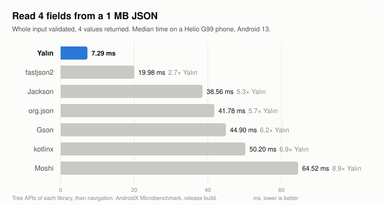
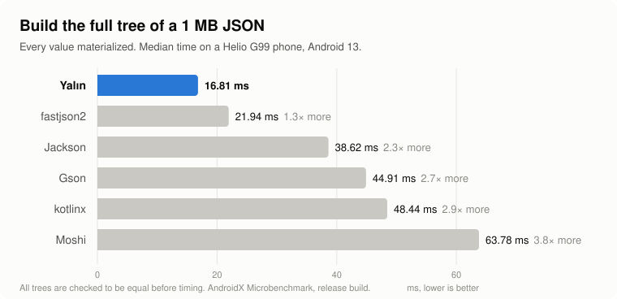
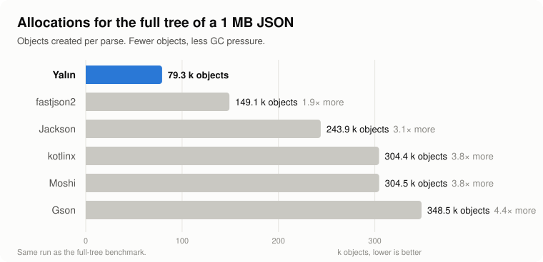
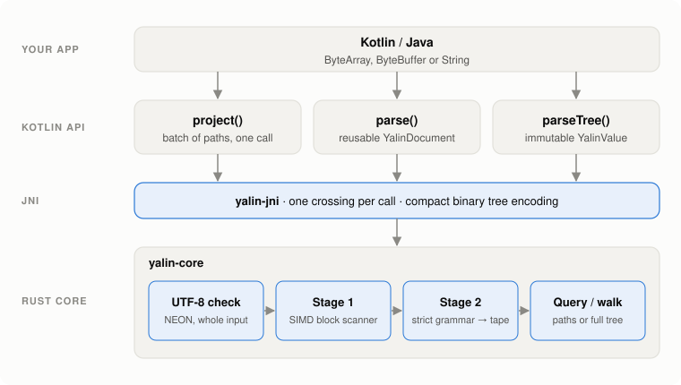
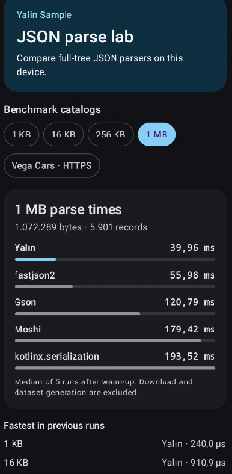

# Yalın

<p align="center">
  
</p>

**Fast, strict JSON for Android, iOS and macOS, powered by a SIMD Rust parser.**

Yalın reads UTF-8 JSON straight from a `ByteArray`. A native parser validates the input and indexes it, and your Kotlin or Java code asks for what it needs: a few fields in one call, or the whole tree as immutable Kotlin values.

<p align="center">
  
</p>

## Why Yalın

- **Fast field reads.** Pull a few values out of a large response without building a tree for it.
- **Fastest full tree from 16 KB up.** 1.3× faster than fastjson2 and 2.7× faster than Gson at 1 MB.
- **Half the garbage.** A full tree creates about half the objects fastjson2 does and a quarter of what Gson does, so the GC has less to do.
- **Strict by default.** Invalid UTF-8, bad escapes, trailing commas and control characters are rejected. Duplicate keys are rejected in trees.
- **Numeric types.** Integers use `Long` or `BigDecimal`; fractional values use `Double` when finite.
- **Small surface.** Three entry points, no annotations, no code generation, no reflection.

## Usage

```kotlin
dependencies {
    implementation("io.github.0xberkay:yalin-android:0.0.2")
}
```

Requires Android API 24+, `arm64-v8a` or `x86_64`, and `compileSdk` 37 or later. Version 0.0.2 is available on Maven Central. To use the latest source, build from source or use the [local Maven publication](docs/releasing.md).

### Read a few fields

One native call, any number of paths. Paths support dotted keys and array indices.

```kotlin
import dev.yalin.YalinJson

val input = """{"user":{"name":"Ada"},"items":[{"price":12.5}]}""".encodeToByteArray()

val fields = YalinJson.project(input, "user.name", "items[0].price")
val name = fields.getString(0)    // "Ada"
val price = fields.getDouble(1)   // 12.5
```

### Query the same document many times

Parse once, then close it with `use`.

```kotlin
YalinJson.parse(input).use { doc ->
    println(doc.getString("user.name"))
}
```

### Build the whole tree

`YalinObject` is a `Map<String, YalinValue>` and `YalinArray` is a `List<YalinValue>`.

```kotlin
val root = YalinJson.parseTree(input) as YalinObject
val user = root["user"] as YalinObject
val name = (user["name"] as YalinString).value
```

An integer that fits in a `Long` becomes `YalinLong`, a number with a fraction or exponent becomes `YalinDouble`, and anything else becomes `YalinBigNumber`. `parseTree` also accepts a `String`.

Typed getters return `null` for a missing field or a JSON `null`; use `kind` to tell them apart. Invalid JSON throws `YalinParseException`.

## iOS and macOS (Swift)

The Swift package uses the same Rust parser. On a Mac with Xcode and rustup, build the XCFramework:

```sh
apple/build-xcframework.sh
```

In Xcode, choose File › Add Package Dependencies › Add Local…, select this checkout, and link the `Yalin` product.

```swift
import Foundation
import Yalin

let data = Data(#"{"user":{"name":"Ada"},"items":[{"price":12.5}]}"#.utf8)
let fields = try Yalin.project(data, "user.name", "items[0].price")
let name = try fields.string(at: 0)

let doc = try Yalin.parse(data)
let price = try doc.double("items[0].price")

let tree = try Yalin.parseTree(data)
let first = tree["items"]?[0]?["price"]?.doubleValue
```

Requires iOS 13 or macOS 10.15. See [Swift guide](docs/apple.md) for errors, numbers, threading, performance notes and benchmarks.

## Use with AI agents

Yalın ships an [agent skill](docs/skills/yalin/SKILL.md) that teaches coding agents how to add the library, choose between `project`, `parse` and `parseTree`, and handle its errors.

**Claude Code:** clone this repository and install the plugin from its local marketplace.

```sh
git clone https://github.com/0xberkay/yalin.git
cd yalin
claude plugin marketplace add ./docs
claude plugin install yalin@yalin
```

**Codex and OpenCode:** both read skills from `~/.agents/skills`, so one command sets up both.

```sh
mkdir -p ~/.agents/skills/yalin && curl -fsSL -o ~/.agents/skills/yalin/SKILL.md \
  https://raw.githubusercontent.com/0xberkay/yalin/main/docs/skills/yalin/SKILL.md
```

To share the skill with your team, put it in the project instead: use `.agents/skills/yalin/` in the repository root and commit it. Older Codex versions read only `~/.codex/skills`, and OpenCode also reads `~/.config/opencode/skills`; use the same command with that folder.

**Other agents:** copy [SKILL.md](docs/skills/yalin/SKILL.md) into the agent's skills folder as `yalin/SKILL.md`, or add it to the agent's instructions file.

## Benchmarks

Every library starts from the same UTF-8 `ByteArray` and validates the whole input. A test checks that all of them return the same result before anything is timed.

<p align="center">
  
</p>

<p align="center">
  
</p>

Yalın against the fastest other library (fastjson2) at each size:

| Input | Read 4 fields | Full tree |
|---|---:|---:|
| 1 KB | **2.6×** faster | 6% slower |
| 16 KB | **4.6×** faster | **1.3×** faster |
| 256 KB | **4.6×** faster | **1.4×** faster |
| 1 MB | **3.4×** faster | **1.3×** faster |

Measured with AndroidX Microbenchmark on an Infinix X6833B (Helio G99, Android 13), release build. Gson, Moshi, kotlinx.serialization, Jackson, fastjson2 and `org.json` were tested. The full numbers, an Exynos 7904 phone and the parser-only results are in [Android benchmarks](docs/benchmarks.md) and [Rust benchmarks](docs/core-benchmarks.md).

## How it works

<p align="center">
  
</p>

Each call crosses JNI once. The core checks UTF-8 over the whole input with NEON, finds structural characters 64 bytes at a time with NEON or SSE2, and records the document on a compact tape. Path queries read the tape directly. Trees are sent to Kotlin in a compact binary form, and repeated keys and short strings are reused across trees.

<pre align="center">
       _     _
      (o)   (o)
  .-.(  \___/  ).-.
 /   /  _   _  \   \
 \  (  (     )  )  /
  `-'\  `---'  /`-'
      `-------'
</pre>
<p align="center">
  <strong>Enjoying Yalın?</strong> Give the project a star on GitHub!
</p>

## Build from source

You need a Rust toolchain with the Android targets, JDK 21 to run Gradle, JDK 17 as the Kotlin toolchain, Android SDK Platform 37 and NDK `28.2.13676358`.

```sh
rustup target add aarch64-linux-android x86_64-linux-android
cargo test --workspace --locked
cd android
./gradlew :yalin-android:testDebugUnitTest :yalin-android:assembleRelease
```

For the Swift package, on macOS run `apple/build-xcframework.sh && swift test`. On Linux, run `cargo build --release -p yalin-ffi && swift test`.

## Android sample app

The [sample app](android/sample-app) compares full-tree JSON parse times on your device using the benchmark catalogs and the Vega Cars dataset.

<p align="center">
  
</p>

## License

Yalın is available under the [Apache License 2.0](LICENSE). See [NOTICE](NOTICE) for attribution. Sample app files from the Android Open Source Project carry their original notices.
